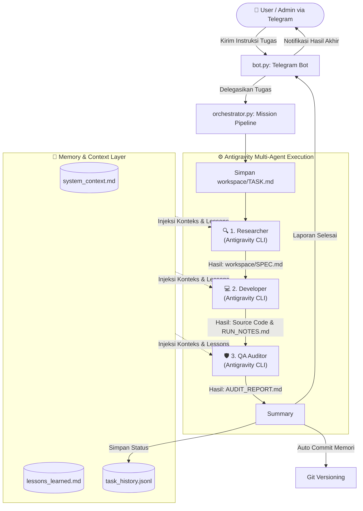

# 🏢 Virtual Office (Mission Control 101)

Sistem otomasi rekayasa perangkat lunak multi-agen otonom berbasis **[Antigravity CLI](https://github.com/google)** yang dikendalikan secara interaktif melalui **Telegram Bot**. 

Proyek ini menghadirkan simulasi tim pengembang virtual (*Virtual Software Engineering Team*) yang bekerja secara berantai—mulai dari riset arsitektur, implementasi kode fungsional, hingga audit penjaminan mutu (QA)—lengkap dengan sistem memori jangka panjang (*long-term memory*) dan sinkronisasi Git otomatis.

---

## 🌟 Fitur Utama

- 🤖 **Pipeline Multi-Agen Terstruktur**:
  - **Researcher**: Menganalisis kebutuhan, merancang skema sistem, dan menyusun spesifikasi teknis (`SPEC.md`).
  - **Developer**: Menerjemahkan rancangan teknis menjadi kode produksi modular serta menyusun panduan instalasi (`RUN_NOTES.md`).
  - **QA (Quality Assurance)**: Mengaudit kode terhadap bug, celah keamanan, dan memberikan status audit (`AUDIT_REPORT.md`).
- 📱 **Telegram Mission Control**: Kirim perintah/tugas langsung dari aplikasi Telegram, terima laporan progres berkala secara *real-time*.
- 🧠 **Persistent Memory & Continuous Learning**: 
  - Menginjeksi standar arsitektur (`system_context.md`) dan evaluasi masa lalu (`lessons_learned.md`) ke setiap agen.
  - Mencatat riwayat tugas ke `task_history.jsonl`.
  - Secara otomatis mencatat dan menyimpan pembaruan memori ke repositori Git.
- 🛡️ **Lingkungan Kerja Terisolasi**: Seluruh hasil kerja agen dihasilkan di folder `workspace/` tanpa mengotori berkas inti sistem.

---

## 🔄 Alur Kerja Sistem (Pipeline Workflow)



---

## 📁 Struktur Direktori

```text
virtual-office/
├── .memory/
│   ├── lessons_learned.md   # Catatan evaluasi agar agen tidak mengulang kesalahan
│   ├── system_context.md    # Standar arsitektur, teknologi, dan prinsip desain
│   └── task_history.jsonl   # Riwayat eksekusi misi dan status akhir
├── agents/
│   ├── developer/
│   │   └── prompt.md        # Prompt instruksi dasar untuk peran Developer
│   ├── qa/
│   │   └── prompt.md        # Prompt instruksi dasar untuk peran QA Auditor
│   └── researcher/
│       └── prompt.md        # Prompt instruksi dasar untuk peran Researcher
├── workspace/               # Sandbox pengerjaan kode (diabaikan oleh .gitignore)
│   ├── TASK.md              # File tugas aktif yang diberikan admin
│   ├── SPEC.md              # Spesifikasi teknis rancangan arsitektur
│   ├── RUN_NOTES.md         # Petunjuk instalasi dan menjalankan kode
│   └── AUDIT_REPORT.md      # Laporan verifikasi dan temuan audit QA
├── .gitignore               # Konfigurasi file yang diabaikan Git
├── bot.py                   # Antarmuka Telegram Bot (Command & Message Handler)
├── memory_manager.py        # Logika injeksi memori, pencatatan log, dan sync Git
├── orchestrator.py          # Pengatur pipeline eksekusi Antigravity CLI
└── requirements.txt         # Daftar dependensi pustaka Python
```

---

## 👥 Peran Agen Virtual

| Agen | Peran | Tanggung Jawab Utama | Berkas Luaran |
|---|---|---|---|
| **Researcher** | Lead Technical Researcher & System Architect | Membedah tugas, menyusun arsitektur sistem, skema basis data, dan daftar dependensi. | `workspace/SPEC.md` |
| **Developer** | Senior Software Engineer | Menulis kode implementasi fungsional, bersih, dan terstruktur sesuai spesifikasi. | Kode sumber & `workspace/RUN_NOTES.md` |
| **QA** | Quality Assurance & Code Auditor | Mengaudit kode terhadap bug, sintaksis, dan celah keamanan. Menilai status `[PASSED]` atau `[NEED_FIX]`. | `workspace/AUDIT_REPORT.md` |

---

## 📋 Prasyarat Sistem

Sebelum menjalankan proyek ini, pastikan sistem Anda memenuhi prasyarat berikut:

1. **Python 3.10+** terpasang di sistem.
2. **Git** terpasang dan dapat diakses dari terminal/command prompt.
3. **Antigravity CLI (`antigravity`)** terpasang dan terkonfigurasi pada PATH sistem.
4. **Akun & Bot Telegram**:
   - Token bot dari [@BotFather](https://t.me/botfather).
   - ID Pengguna Telegram Anda (bisa didapatkan melalui [@userinfobot](https://t.me/userinfobot)).

---

## 🚀 Panduan Instalasi & Konfigurasi

### 1. Kloning Repositori
```bash
git clone https://github.com/luqni/mission-controll-101.git
cd mission-controll-101
```

### 2. Siapkan Python Virtual Environment
```bash
# Membuat virtual environment
python -m venv venv

# Mengaktifkan virtual environment:
# Windows (PowerShell):
.\venv\Scripts\Activate.ps1
# Linux/macOS:
source venv/bin/activate
```

### 3. Pasang Dependensi
Pasang pustaka yang dibutuhkan:
```bash
pip install -r requirements.txt
```

### 4. Konfigurasi Kredensial
Buka berkas `bot.py` dan sesuaikan token bot serta ID Telegram admin:
```python
BOT_TOKEN = "MASUKKAN_BOT_TOKEN_DARI_BOTFATHER"
ADMIN_TELEGRAM_ID = 123456789  # Ganti dengan User ID Telegram Anda
```

> 💡 **Tips Keamanan**: Untuk penggunaan jangka panjang atau produksi, disarankan menggunakan *environment variable* (misalnya dengan pustaka `python-dotenv`) agar token tidak terekspos dalam kode.

---

## 💻 Cara Menggunakan

1. **Jalankan Bot**:
   ```bash
   python bot.py
   ```
2. **Buka Telegram**:
   - Cari bot Anda di Telegram dan ketik `/start`.
   - Bot akan memverifikasi ID Telegram Anda dan menampilkan pesan sambutan *Mission Control*.
3. **Kirim Instruksi Tugas**:
   - Cukup kirim pesan teks berisi instruksi pembuatan fitur atau sistem baru, contoh:
     > *"Buat modul autentikasi JWT lengkap dengan middleware dan refresh token menggunakan Fastify."*
4. **Pantau Eksekusi**:
   - Bot akan mengirimkan kabar berkala:
     - 🚀 *Mission received & pipeline started*
     - ⚙️ Progres **RESEARCHER** ➔ **DEVELOPER** ➔ **QA**
     - 💾 Sinkronisasi Git untuk memori sistem
     - 🏁 Konfirmasi penyelesaian misi
5. **Cek Hasil di Folder `workspace/`**:
   - Buka direktori `workspace/` pada komputer Anda untuk melihat spesifikasi, implementasi kode jadi, catatan instalasi, dan laporan audit QA.

---

## 🧠 Konsep Pembelajaran & Memori Mandiri

Sistem dirancang agar semakin cerdas seiring berjalannya waktu:
- **`system_context.md`**: Berisi panduan rekayasa acuan yang dipatuhi seluruh agen (misal: stack default, arsitektur modular, standar sanitasi input).
- **`lessons_learned.md`**: Menyimpan catatan koreksi dan evaluasi dari proyek-proyek sebelumnya. Catatan ini diinjeksi ke prompt agen pada setiap putaran misi agar kesalahan yang sama tidak terulang.
- **Git Sync**: Setiap akhir misi, histori dan memori akan otomatis di-commit ke Git secara terstruktur (`chore(agent): update memory...`).

---

## 📄 Lisensi

Proyek ini dikembangkan untuk eksplorasi dan otomasi pengembangan perangkat lunak berbasis AI multi-agen. Silakan sesuaikan dan kembangkan sesuai kebutuhan tim Anda.
